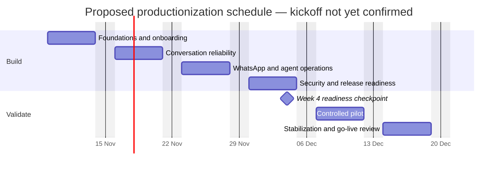

# Shraddha Properties: product roadmap

**Status updated:** 6 November 2026 · **Target:** production pilot of up to
100 conversations/day · **AWS Region:** Sydney (`ap-southeast-2`).

Plan for **4–6 calendar weeks and approximately 20–28 engineering days**, with
one experienced engineer working consistently. Twilio/Meta registration and
verification, access to business content, and stakeholder decisions are external
dependencies that may extend the schedule. This is a planning estimate, not a
delivery commitment.

## Timeline and weekly progress

The calendar below assumes a **proposed kickoff on Monday, 9 November 2026**;
the kickoff has not been agreed. Shift all dates together when the actual start
is confirmed. Dates are in Asia/Kolkata. Each bar measures completed production
exit checks for that week, not elapsed time or POC completion.

**POC baseline: `[██████████] 100%` for the agreed POC scope.**
Production hardening has not started, so the weekly production bars begin at 0%.
Existing POC capabilities are reusable inputs, not proof that production gates
have passed.

| Week | Proposed dates | Work and milestone | Progress | Status |
| --- | --- | --- | --- | --- |
| **1 — Foundations** | **9–13 Nov 2026** | Agree scope; start sender onboarding; introduce durable message acceptance | `[░░░░░░░░░░] 0%` | Not started |
| **2 — Conversation reliability** | **16–20 Nov 2026** | Persistent state, duplicate handling, catalog validation, retry/replay tests | `[░░░░░░░░░░] 0%` | Not started |
| **3 — WhatsApp and agent operations** | **23–27 Nov 2026** | Registered sender, rich WhatsApp rendering, delivery tracking, agent workflows | `[░░░░░░░░░░] 0%` | Not started; sender setup dependency |
| **4 — Readiness checkpoint** | **30 Nov–4 Dec 2026** | Protected APIs, staging, actionable alerts, versioned rollout and rollback | `[░░░░░░░░░░] 0%` | Not started |
| **5 — Controlled pilot** | **7–11 Dec 2026** | Invited users, agent validation, analytics reconciliation, issue resolution | `[░░░░░░░░░░] 0%` | Not started; readiness gate required |
| **6 — Stabilization and go-live** | **14–18 Dec 2026** | Resolve priority defects, exercise recovery, review operating evidence, approve expansion | `[░░░░░░░░░░] 0%` | Not started; pilot evidence required |

An earlier controlled pilot is possible at the Week 4 checkpoint only if sender
setup, security, reliability, and real-phone acceptance checks have passed. The
recommended baseline retains Weeks 5–6 for pilot observation and stabilization.

## Reusable POC baseline

- [x] Conversation engine for Villas, Apartments, and Office Space.
- [x] Rich website tester, property cards, and brochure/price/location/visit previews.
- [x] AWS deployment and signed incoming-message capture.
- [x] Automated conversation scenarios and 32 passing backend tests at handoff.
- [x] DynamoDB-backed test contact-interest and visit-request submissions.
- [x] Aggregate lead/visit analytics and an initial CloudWatch dashboard.
- [x] Architecture, cost assumptions, and session handoff documentation.

This baseline remains capture-only. The current lead table does not provide
conversation-state persistence or customer-message deduplication. The website's
HTML cards are not yet a WhatsApp media/button implementation. Visit preferences
are not bookings, and no agent notifications are sent.

## Engineering work packages

Work packages overlap across the weekly calendar; effort is not an additional
duration to add on top of that calendar.

| Package | Scope | Engineering effort | Completion milestone |
| --- | --- | ---: | --- |
| 1. Production scope | Journeys, fields, responsibilities, privacy/retention, success targets | 1–2 days | Requirements and acceptance criteria agreed |
| 2. Reliable processing | Validating ingress, SQS FIFO, worker separation, retries, failed-message queue, duplicate handling | 3–4 days | Accepted events survive processing failures |
| 3. Stateful conversations/catalog | Persistent stage/property, contextual follow-ups, expiry, reset, controlled catalog updates | 3–4 days | Conversations continue correctly across requests |
| 4. WhatsApp integration | Sender setup, media/documents/buttons, templates, delivery callbacks | 3–4 days | Full journeys work on actual phones |
| 5. Lead and visit operations | Protected management view, status updates, assignment, notifications, visit confirmation | 3–4 days | Agents manage enquiries through completion |
| 6. Security and operations | Environment separation, API authentication, scoped IAM, alerts, release/rollback | 3–4 days | Controlled access and tested recovery |
| 7. Validation and pilot | Failure/duplicate/burst/device testing, controlled pilot, stabilization | 4–6 days | Evidence supports go-live approval |
| **Total** | **Core pilot release** | **20–28 days** | **All mandatory go-live checks pass** |

## Weekly exit checks

Each week has five equally weighted exit checks. Progress is:
`completed checks / 5 × 100`. Update the checklist and the corresponding weekly
bar together. A blocker does not count as completed work.

### Week 1 — Foundations · 9–13 November

- [ ] Approve the discovery, brochure, pricing, enquiry, visit, and handoff journeys.
- [ ] Agree lead fields, ownership, privacy/retention, availability and recovery targets.
- [ ] Submit the required Twilio/Meta onboarding information; record external blockers.
- [ ] Implement signature-validating ingress that acknowledges only durably queued events.
- [ ] Demonstrate enqueue failure handling and per-conversation queue grouping.

**Outcome:** agreed scope and a durable acceptance path. Starting onboarding is
not the same as obtaining sender approval.

### Week 2 — Conversation reliability · 16–20 November

- [ ] Persist conversation stage, selected category/property, and session expiry.
- [ ] Implement durable message-processing claims and duplicate handling.
- [ ] Support contextual follow-ups, invalid selections, restart, and MENU.
- [ ] Add validated, controlled catalog updates and missing-fact handling.
- [ ] Test worker failure, retry, failed-message routing, and safe replay.

**Outcome:** message processing survives restarts and retains customer context.
Ambiguous provider sends must be reconciled; do not promise exactly-once delivery.

### Week 3 — WhatsApp and agent operations · 23–27 November

- [ ] Complete sender setup and verify basic real-phone sending and receiving.
- [ ] Implement supported WhatsApp images, brochure documents/links, buttons, and templates.
- [ ] Persist outbound MessageSids and process signed delivery-status callbacks.
- [ ] Add protected lead records, assignment, status progression, and approved agent notifications.
- [ ] Implement agent-controlled visit confirmation and cancellation/rescheduling status.

**Outcome:** real WhatsApp conversations flow into a usable agent process.
Retain separate request and confirmed-booking states. A live calendar/CRM
integration is outside the baseline unless explicitly added to scope.

### Week 4 — Security and release readiness · 30 November–4 December

- [ ] Isolate test/customer traffic and authenticate management and test APIs as required.
- [ ] Establish staging and scoped deployment/execution access; review secret/data handling.
- [ ] Connect approved notification destinations and verify actionable failure alerts.
- [ ] Use immutable versions/aliases, monitored release rollout, and a tested rollback.
- [ ] Complete end-to-end acceptance testing and document the readiness decision.

**Outcome:** a controlled release can be approved, detected as faulty, and reversed.
Reaching the calendar date alone does not authorize customer launch.

### Week 5 — Controlled pilot · 7–11 December

- [ ] Invite a small, agreed group of users and assign agent/incident ownership.
- [ ] Validate each conversation branch on real phones and supported content types.
- [ ] Review unanswered questions, duplicates, delivery failures, and agent follow-up.
- [ ] Reconcile analytics against stored submissions and message delivery outcomes.
- [ ] Fix priority pilot defects and update regression tests.

**Outcome:** real pilot evidence replaces assumptions about end-to-end behavior.
Keep synthetic tests and real customer analytics separated.

### Week 6 — Stabilization and go-live · 14–18 December

- [ ] Resolve launch-blocking defects and repeat affected acceptance tests.
- [ ] Exercise backup restoration, failed-message recovery, and deployment rollback.
- [ ] Review throughput, latency, delivery outcomes, operating cost, and open risks.
- [ ] Finalize the runbook, escalation path, and business/operational ownership.
- [ ] Record the go/no-go decision and expansion limits for the 100-conversations/day pilot.

**Outcome:** an approved, supportable pilot release with documented limitations.

## Progress bar update guide

Use plain Markdown bars so the roadmap works without external badge services.

| Completed checks | Percentage | Bar |
| ---: | ---: | --- |
| 0/5 | 0% | `[░░░░░░░░░░] 0%` |
| 1/5 | 20% | `[██░░░░░░░░] 20%` |
| 2/5 | 40% | `[████░░░░░░] 40%` |
| 3/5 | 60% | `[██████░░░░] 60%` |
| 4/5 | 80% | `[████████░░] 80%` |
| 5/5 | 100% | `[██████████] 100%` |

These bars are manually maintained. When completing a check, add evidence (test
report, deployed version, issue/PR, or approval) and update the date. Do not
increase progress merely because time passed. Record schedule changes explicitly.

## First production release: product boundary

| Area | Required capability |
| --- | --- |
| Customer conversation | Stateful discovery, factual details, supported media, enquiry capture, agent handoff |
| Property operations | Controlled listing/availability updates and original media/document management |
| Lead management | Authorized records, assignment, contact history, and status progression |
| Site visits | Preferences, agent confirmation, cancellation/rescheduling, and appropriate reminders |
| Analytics | Separate test/production activity, lead funnel, visit outcomes, property interest, delivery failures |
| Reliability | Durable queue, bounded retries, duplicate handling, failed-message recovery, delivery tracking |
| Operations | Staging, monitored releases, rollback, alerts, backup/recovery procedures |

## Mandatory go-live conditions

- [ ] No lost accepted messages in the agreed failure tests.
- [ ] Duplicate handling and ambiguous-send recovery are demonstrated.
- [ ] Every supported branch passes real-phone acceptance tests.
- [ ] Delivery failures are visible to the operating team.
- [ ] Customer and management data are accessible only to authorized users.
- [ ] Restore, replay, and rollback exercises pass.
- [ ] Analytics reconcile with stored records and delivery outcomes.
- [ ] Named owners accept responsibility for enquiries and incidents.

The proposed 99.9% monthly availability target is a goal to measure after launch,
not an established SLA. Functional tests do not prove availability. The baseline
keeps a single AWS Region in Sydney; regional recovery requires separate planning
if future business requirements justify it.

## Dependencies, exclusions, and scope changes

Business inputs needed: verified property facts, original brochures/photos,
business identity and sender information, agent owners, notification destinations,
retention decisions, and acceptance of the operating budget.

The baseline excludes multilingual journeys, generative-AI answers, CRM/calendar
integration, payments, a full customer property portal, multi-region recovery,
and high-volume marketing campaigns. Estimate those separately before adding
them to the schedule. Productionization engineering effort is separate from
monthly pay-per-use charges.

## Related plans

- [Architecture and detailed actions](docs/PILOT-ARCHITECTURE.md)
- [Pay-per-use pilot costs](docs/PILOT-COSTS.md)
- [Current lead and visit analytics](docs/LEAD-ANALYTICS.md)
- [Implemented POC workflow](WORKFLOW.md)
- [Session handoff](docs/RESUME.md)
