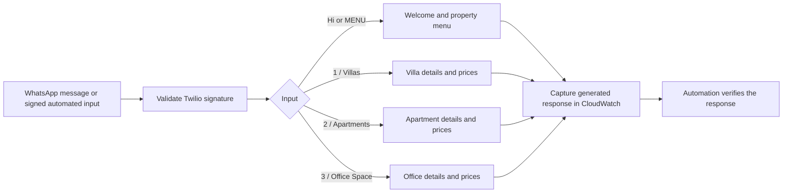

# Shraddha Properties conversation workflow

For the proposed reliable messaging pipeline and the role of persistent
conversation state, see the [pilot architecture and detailed action
plan](./docs/PILOT-ARCHITECTURE.md).

The deployed service runs in Sydney (`ap-southeast-2`) with
`REPLY_TRANSPORT=capture`. It receives signed Twilio messages, generates answers,
and records a structured `workflow_response` event in CloudWatch. It returns an
empty HTTP 204 acknowledgement and makes no WhatsApp send requests.

## Conversation

`Hi` / `Hello` / `MENU` returns:

> Hi, welcome to Shraddha Properties!
> Please let me know what you are looking for:
> 1. Villas
> 2. Apartments
> 3. Office Space
> Reply with a number or the property type.

The user can type `1` / `Villas`, `2` / `Apartments`, or `3` / `Office Space`.
Each branch shows matching listing IDs, locations, size, price and availability.
All six current records are fictional demo data. `MENU` starts again; an unknown
choice prompts the user to choose a supported category. Questions containing an
ID (for example `price DEMO-001`) use the structured listing answer function.

Selections are typed text, not WhatsApp interactive buttons. The fixed menu can
be resolved without remembering a previous turn, so this version does not use
in-memory sessions or depend on one Lambda instance handling both messages.

## Workflow



## Automated verification

`test_conversation.py` tests every menu branch and confirms capture mode never
calls the outbound sender. `automate_workflow.py` submits three two-turn
conversations to the live signed webhook and compares each CloudWatch-captured
response against the shared workflow engine. It refuses to run unless the
deployed Lambda has capture mode enabled.

Run local tests:

```bash
python3 -m unittest test_property_bot test_conversation -v
```

Run live automation with TWILIO_AUTH_TOKEN securely set in the process environment
and AWS credentials that can read the stack, Lambda configuration and logs:

```bash
python3 automate_workflow.py \
  --url https://xm62t0ivx8.execute-api.ap-southeast-2.amazonaws.com/webhook/whatsapp \
  --region ap-southeast-2 \
  --log-group /aws/lambda/property-whatsapp-bot-PropertyBot-us7mfKOt1IYp \
  --output-dir outputs
```

The resulting HTML report shows the conversations and generated replies. JSON
results retain correlation IDs and pass/fail details. Automation tests the AWS
webhook and capture path; it does not simulate WhatsApp delivery.

To inspect an actual inbound WhatsApp message, open the function's CloudWatch log
group and search `workflow_response` or the Twilio MessageSid. The event includes
the incoming text, workflow stage and generated answer, but excludes the phone
number and auth token. Log retention is 14 days. Duplicate webhook deliveries may
create duplicate capture events; no outbound messages are sent in this mode.

The latest demo CSV adds `property_type` (`villa`, `apartment`, `office`) and an
office row. The original five-record workbook predates this workflow; use the
current CSV/catalog when modifying categories.
