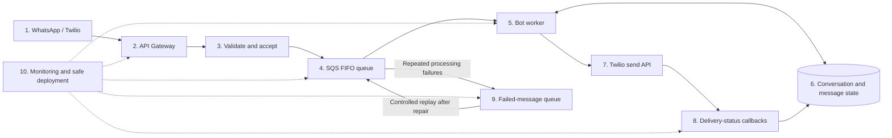

# Shraddha Properties pilot architecture and action plan

This document describes the proposed reliability improvements for a pilot of up
to 100 conversations per day in AWS Sydney (`ap-southeast-2`). It is an
implementation plan, not a claim that the proposed components are deployed.

See the [pay-per-use pilot cost estimate](PILOT-COSTS.md) for monthly scenarios,
provider fees, infrastructure allowances, and excluded costs.

See the [product roadmap](../PRODUCT-ROADMAP.md) for the proposed six-week
timeline, weekly progress bars, and production exit checks.

## Current implementation and target

The current POC uses API Gateway and a synchronous Flask application on Lambda.
It validates Twilio signatures, runs `conversation.py`, and captures generated
responses in CloudWatch. The private Bot Lab website calls a separate demo test
route in the same function. Replies are not sent to WhatsApp in capture mode.

The POC has no durable queue, persistent conversation state, message
deduplication store, or delivery callback handler. Its error alarm currently has
no notification destination. Catalog data is packaged JSON. Releases currently
update the unqualified Lambda function rather than a production version alias.

The target below adds durable acceptance, ordered processing, recovery,
conversation state, delivery tracking, and safer releases. Keep the website
tester in capture mode while these changes are implemented.

## High-level diagram



SQS moves repeatedly failing work into the failed-message queue through its
redrive policy. The worker raises or reports failures; it does not manually
delete and move failed messages as its normal retry mechanism.

## Where the conversation is held

**Step 5 decides what happens next. Step 6 remembers the customer's progress.**
For each incoming message, the worker loads state, interprets the input,
generates the next response, and saves the resulting state and processing
outcome. Processing must account for concurrent updates and interrupted sends.

| Customer message | Step 5: processing | Step 6: stored progress |
| --- | --- | --- |
| Hi | Generate the welcome menu | `stage: choose_category` |
| Villas | Show matching villas | `stage: choose_property`, `category: villa` |
| Select a villa | Show that property's available actions | `selected_property: DEMO-004` |
| Price details | Return the selected property's recorded price | Retain the selected property |
| MENU | Return to the category menu | Clear the previous selection |

The current POC avoids needing this storage by sending explicit commands such
as `price DEMO-004` from its buttons. It cannot reliably interpret contextual
follow-ups such as "What's its price?" across independent messages without
adding persistent state. A Lambda process's memory must not be the authoritative
conversation store.

## 1. WhatsApp / Twilio: receive customer messages

### Actions

- Upgrade Twilio and register a supported WhatsApp business sender when ready
  for paid end-to-end testing. Do not assume the current trial number becomes
  the permanent business sender.
- Configure the incoming-message webhook and a separate delivery-status
  callback endpoint.
- Implement a WhatsApp rendering adapter for the shared conversation results:
  welcome choices, property images, concise specifications, brochure documents
  or links, and supported interactive buttons.
- Keep web presentation separate from WhatsApp presentation. HTML cards and SVG
  illustrations do not automatically become WhatsApp cards or button messages.
- Use only recorded property facts. Clearly identify demo listings and missing
  original brochures. Keep visit preferences pending until an actual booking
  integration or agent confirms them.

**Completion check:** A real message reaches AWS with its MessageSid, sender,
recipient, and input text or supported interactive selection.

## 2. API Gateway: expose and protect endpoints

| Route | Responsibility |
| --- | --- |
| `POST /webhook/whatsapp` | Receive customer messages |
| `POST /webhook/status` | Receive Twilio delivery updates; proposed |
| `POST /test/workflow` | Simulate the workflow for the website tester |
| `GET /health` | Basic service health |

### Actions

- Preserve HTTPS and request-size validation.
- Isolate test traffic from customer traffic, including capacity and rate
  limits. The current shared stage has a 5 requests/second rate and burst of 10.
- Authenticate the test API before exposing real catalog or customer data.
  The website's private access does not authenticate its separate AWS API;
  CORS is a browser restriction, not an authorization mechanism.
- Keep public Twilio webhook routes authenticated through signature validation.
- Record request IDs, status codes, latency, and integration failures. Exclude
  credentials and unnecessary personal data from operational logs.

**Completion check:** Invalid requests are rejected, legitimate requests work,
and running website tests cannot exhaust customer-message capacity.

## 3. Validate and accept: verify and enqueue

Use a small ingress Lambda. Do not generate a response or wait for an outbound
Twilio API request before acknowledging the incoming message.

### Actions

1. Validate the Twilio signature against the exact external URL and request.
2. Validate required fields, supported message types, and payload size.
3. Normalize the request into an internal event with a schema version.
4. Enqueue it in SQS.
5. Return a successful acknowledgement only after SQS confirms acceptance.
6. If enqueueing fails, return a failure and record it for retry and monitoring.

Example internal event:

```json
{
  "message_id": "Twilio MessageSid",
  "conversation_id": "internal customer identifier",
  "message_type": "text",
  "text": "Villas",
  "received_at": "UTC timestamp",
  "schema_version": 1
}
```

Use MessageSid for correlation. Protect any mapping between internal customer
identifiers and phone numbers rather than putting raw phone numbers in routine
log messages.

**Completion check:** Every successfully acknowledged event was durably accepted
by the queue. Invalid signatures create no queued work.

## 4. SQS FIFO: buffer work and support recovery

### Actions

- Use one message group per conversation, allowing different customers to be
  processed independently while preserving the queue's per-group order.
- Use MessageSid as the message deduplication identifier. Also implement durable
  application deduplication; queue deduplication has a limited window.
- Set visibility timeout with sufficient headroom above worker execution time
  and any batching window, following AWS event-source guidance.
- Configure message retention, a redrive policy, and a failed-message queue.
- Bound worker concurrency according to the sender's verified throughput and
  account limits. Implement provider-aware pacing rather than assuming that
  Lambda concurrency alone enforces a messages-per-second rate.
- Use partial batch failure handling. For FIFO batches, preserve ordering when
  reporting failed and unprocessed messages.
- Monitor oldest-message age, backlog, and failed-message queue depth.

**Completion check:** Bursts remain queued safely; worker failure makes the
message eligible for retry; one conversation does not reorder its queued work.
Upstream webhook arrival order still needs consideration if events arrive late.

## 5. Bot worker: execute the conversation

### Actions

1. Load the customer's conversation state and incoming-message processing record.
2. Claim the message safely or recognize an already completed duplicate.
3. Interpret the input in the context of the stored stage.
4. Read recorded catalog facts and apply the conversation transition.
5. Generate the shared response representation.
6. Render it for WhatsApp or capture it for testing.
7. Record processing and outbound-send progress so interrupted work is recoverable.
8. Save the next conversation state and completion outcome consistently.

| Current stage | Input | Response / next action |
| --- | --- | --- |
| Start | Hi | Welcome and property category choices |
| Choose category | Villas / Apartments / Office Space | Matching properties |
| Choose property | A property selection | Brochure, price, location, and visit options |
| Property options | Price details | Recorded price and missing-charge caveats |
| Property options | Brochure | Available original document or labelled generated overview |
| Property options | Site visit | Collect preferences; await confirmation |
| Any stage | MENU | Reset to category selection |

Unknown facts should trigger a clarification or agent handoff, not invented
availability, prices, amenities, or booking confirmations.

**Completion check:** The same input and stored state yield consistent outcomes
across the website tester and WhatsApp adapter. Worker restarts preserve progress.

## 6. Conversation and message state: remember progress

A durable key-value store such as DynamoDB is suitable for these records.
The removed legacy conversation logger was not a session or deduplication
implementation. The current lead table stores submissions, not conversation state.

| Logical record | Required information |
| --- | --- |
| Conversation | Stage, category, selected property, last activity, state revision |
| Incoming message | MessageSid, claim/processing status, attempts, timestamps |
| Outgoing response | Related incoming MessageSid, outbound Twilio SID, delivery state |
| Visit preference | Property, requested date, pending/confirmed status |

### Actions

- Use conditional writes or transactions where appropriate to prevent two
  workers claiming or overwriting the same processing transition.
- Define expiry and customer-data retention policies. Check expiry in application
  logic: DynamoDB TTL deletion is asynchronous, not immediate session expiry.
- Enable point-in-time recovery where appropriate and test restoration.
- Separate catalog management from temporary session state as operations grow.
- Track uncertain outbound sends explicitly. A timeout after Twilio accepted a
  request can leave the worker without the returned SID. Reconcile that outcome
  before retrying; do not promise exactly-once external delivery.

**Completion check:** Replaying an incoming message does not normally create a
second reply; an interrupted operation can resume or be reconciled safely.

## 7. Twilio send API: submit the response

### Actions

- Use the configured, registered business sender.
- Render supported text, media, documents, and interactive content.
- Respect WhatsApp's customer-service window and approved-template requirements.
- Configure connection/read timeouts and bounded retries with backoff.
- Retry transient network errors, rate limits, and temporary provider failures.
  Surface invalid credentials, unsupported content, and invalid templates as
  permanent or operator-actionable failures.
- Persist the returned outbound MessageSid and its accepted/queued outcome.
- Supply the delivery callback URL.
- Preserve capture mode for automated tests. Never let a website simulation
  silently enable sending to a real customer.

**Completion check:** A successful send has a stored Twilio SID. Accepted is not
reported as delivered, and permanent errors do not retry indefinitely.

## 8. Delivery-status callbacks: establish the outcome

### Actions

- Validate Twilio's callback signature.
- Match the outbound MessageSid to the stored response and conversation.
- Record delivery, failure, and undelivered outcomes, including error codes.
- Handle repeated and out-of-order callbacks without regressing known state.
- Acknowledge callbacks promptly after persisting or durably queueing them.
- Reconcile messages stuck in intermediate states and alert on abnormal failure
  rates or delays.

**Completion check:** An incoming customer message can be traced through
processing, sending, and delivery or an actionable failure.

## 9. Failed-message queue: inspect, repair, and replay

### Actions

- Configure redrive after a bounded number of failed processing attempts.
- Notify an operator when failed work appears.
- Retain correlation ID, failure category, and attempt history without putting
  secrets in diagnostic records.
- Repair the underlying cause before replaying.
- Preserve the original message identity and check for an already-created
  outbound response when replaying.
- Document ownership, escalation, and a controlled replay procedure.
- Define what happens to an older conversation message replayed after newer
  messages have progressed the state; do not blindly apply obsolete transitions.

**Completion check:** A deliberately broken event reaches the queue, generates
an alert, and can be recovered without losing history or duplicating a known send.

## 10. Monitoring and safe deployment: support every step

### Actions

- Attach a real notification destination to alarms. Monitor API 5xx separately
  from Lambda Errors: caught exceptions can produce HTTP failures without a
  corresponding Lambda runtime error.
- Monitor throttling, queue age/backlog, worker failures, failed-message queue
  entries, and Twilio delivery failures.
- Add scheduled synthetic conversations in capture mode.
- Keep staging and production separate.
- Publish immutable Lambda versions, use aliases, and introduce gradual rollout
  with monitored rollback conditions.
- Test rollback before accepting customers.
- Replace the broad AdministratorAccess deployment user with a scoped deployment
  role and short-lived credentials after the deployment workflow is established.
- Review secret rotation, retention/redaction, dependency updates, and budget alerts.

Track webhook acceptance, response-generation success, and actual WhatsApp
delivery separately. A proposed initial availability target is 99.9% monthly;
this is a target to measure, not a demonstrated SLA. At 30 days that corresponds
to about 43 minutes of downtime. Define recovery targets before making stronger
availability commitments. One Region is appropriate for the pilot; revisit
regional recovery when business requirements justify it.

**Completion check:** An operator can detect a fault, identify the affected
messages, recover failed work, and reverse a bad release through a tested process.

## Implementation phases and acceptance tests

| Phase | Deliverables | Exit condition |
| --- | --- | --- |
| 1. Recoverability | Ingress, FIFO queue, worker, persistent processing records, failed-message queue | Accepted messages survive worker failures and retries |
| 2. Visibility | Delivery callbacks, dashboards, notifications | Every test message has a traceable outcome |
| 3. Safe operations | Authenticated/isolated tester, staging, aliases, rollback | A bad release is detected and safely reversed |
| 4. WhatsApp integration | Paid sender setup, supported media/buttons, template handling | Full conversations work on real phones |
| 5. Pilot validation | Burst, duplicate, provider-failure, replay, and recovery exercises | Agreed reliability targets are demonstrated |

Required failure tests include invalid signatures, queue-enqueue failure, worker
timeout, duplicate MessageSid, provider rate limiting, ambiguous send outcomes,
duplicate/out-of-order callbacks, failed-message replay, and rollback. Load-test
the AWS processing path in capture mode; observe provider testing restrictions
before generating WhatsApp traffic.

## Reference documentation

- [AWS: Using Lambda with SQS](https://docs.aws.amazon.com/lambda/latest/dg/with-sqs.html)
- [AWS: Lambda resilience](https://docs.aws.amazon.com/lambda/latest/dg/security-resilience.html)
- [AWS: Lambda versions](https://docs.aws.amazon.com/lambda/latest/dg/configuration-versions.html)
- [AWS: DynamoDB TTL](https://docs.aws.amazon.com/amazondynamodb/latest/developerguide/TTL.html)
- [Twilio: WhatsApp sender registration](https://www.twilio.com/docs/whatsapp/self-sign-up)
- [Twilio: WhatsApp trial restrictions](https://www.twilio.com/docs/usage/trials/try-out-whatsapp)
- [Twilio: WhatsApp buttons](https://www.twilio.com/docs/whatsapp/buttons)
- [Twilio: Delivery status tracking](https://www.twilio.com/docs/messaging/guides/track-outbound-message-status)

See [the implemented conversation workflow](../WORKFLOW.md) for the current
capture-mode behavior, and [the original architecture](../ARCHITECTURE.md) for
the broader marketing-platform concept.
